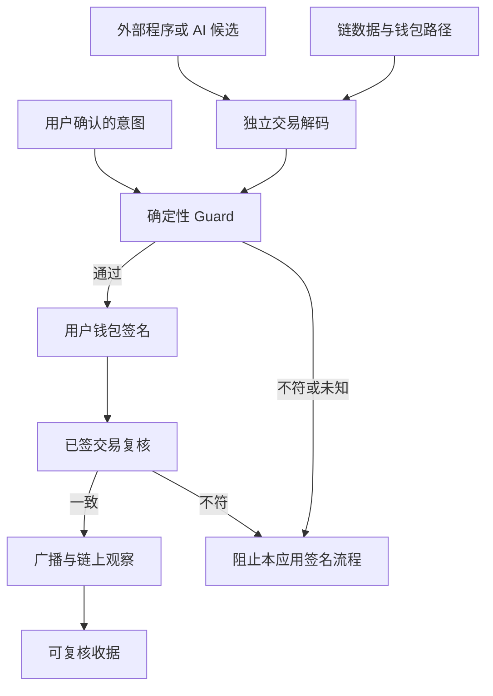
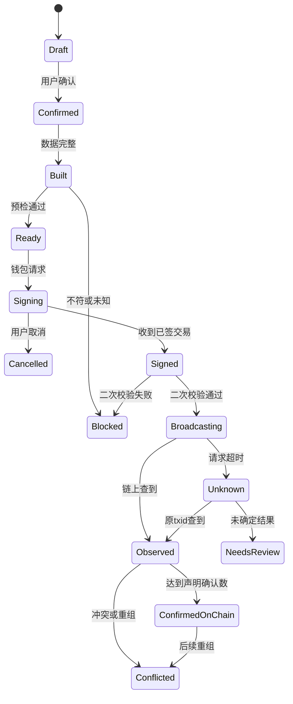

# 架构、数据契约与状态机

## 1. 最小实现形态

采用 **一个 TypeScript Web 应用 + 一个无副作用 guard 模块 + 可替换链适配器**。已有 Next.js 项目先复用，不为文档形式强制重建 monorepo。没有旧项目时，先建立单应用；guard 模块后续自然提取为 package。保留一个包管理器和 lockfile。

建议目录（内部命名，可随真实仓库调整）：

- `src/domain/intent/`：请求解析、严格金额解析、用户确认、规范化。
- `src/domain/guard/`：候选与已签交易检查、报告、错误码；不访问网络。
- `src/adapters/bch/`：链数据获取、CashTokens 解码、txid、广播与确认查询。
- `src/adapters/wizardconnect/`：会话、地址路径、连接/取消/签名能力。
- `src/services/payment/`：状态机、幂等、意图过期、恢复。
- `src/services/receipt/`：链事实核验、应用订单关联、导出。
- `src/app/`：UI/API；根据实际框架调整。
- `examples/integrate-guard/`：独立调用演示，用于证明不是 UI 内硬编码演出。
- `tests/fixtures/`：标明来源的真实脱敏交易或合成攻击载荷，分开放置。
- `evidence/`：已执行结果；不把模板自动当作完成证明。

P0 可用服务端只读链代理，减少浏览器 Electrum WebSocket/CORS 适配问题；是否可在浏览器直连由 spike 决定。服务端不需要用户私钥、钱包 xpub 或热钱包。纯预检示例可以无数据库；最终公开付款/订单/收据关联流程需要最低限度的持久事务存储，以支持operation状态比较更新、重启恢复和唯一约束。复用一个现有数据库，不另建复杂后台。

开发期可用 SQLite；无持久盘的 serverless 部署不能把它当持久数据库。采用部署平台已有数据库或选择支持持久文件的运行环境，保持单一运行模式。后续引入 Supabase/Render 时依照实际能力与官方文档实施，本包不假设它们已连接或已开通。

## 2. 信任边界



外部候选、LLM 输出、网络服务给出的元数据、钱包返回值都要验证。不要同时让同一个可变对象生成“用户意图”和“待检查交易”，否则攻击者同时改两边就失去检查意义。用户确认后保存不可变规范化意图及 hash；修改任何资金字段必须重新确认。

P0信任模型是指定节点报告状态，加本地解析原始交易并复算txid。复算只能确认原交易与outpoint对应，不能单独证明已经上链、仍未花费或确认数真实。保留provider和时点，不声称已实现SPV证明或无需信任任何节点；本期不为此自建验证网络。

普通 dApp 内 Guard 能证明的是“本次集成流程进行了这些检查”。如果运行页面本身恶意、Guard 被移除、钱包已被控制，该组件不能提供全局保护。对外文案必须保持这个边界。

## 3. 资产登记

主网配置与测试配置分开。以下是已核查的资产标识，启动时仍重查发行方来源与网络；不能只信本文件。[S10–S11, S18]

| 项 | 值 | 说明 |
| --- | --- | --- |
| BCH 主网 PUSD category | `2469acc5afa4b10cb5b5c04afb89c3a3ffd61c5da9c01e26d00951cae2a02544` | SDK 显示/登记用 32 字节十六进制 |
| PUSD 显示小数位 | `2` | `1.00` 对应 `100` 基础单位 |
| 合约 VM 小端表示 | `4425a0e2ca5109d0261ec0a95d1cd6ffa3c389fb4ac0b5b50cb1a4afc5ac6924` | 本期无自建合约；不得在 SDK 层重复反转 |
| Avalanche 原生 USDC | `0xB97EF9Ef8734C71904D8002F8b6Bc66Dd9c48a6E` | 可选后续，链 ID `43114`、小数位 `6` |

不硬编码未知的 EMBER2026 category 或用户接收地址。投票地址通过 CashAddr 解码验证网络、checksum 与 token-aware 类型，不能只检查以 `z` 开头；其他合规 CashTokens 地址类型亦可能有效。使用的地址须来自用户控制的钱包，保留真实验证结果。

PUSD 资产类别中存在 NFT 相关元数据，不代表每个该类别 UTXO 都只有 fungible amount。P0 必须检查具体 UTXO 是否包含 NFT；名称、icon、decimals 不是忽略 NFT 的理由。[S11]

## 4. 规范化数据契约

以下是**本项目内部设计**，不是 CashScript/WizardConnect 官方类型。实现时尽量复用官方类型，并通过 adapter 映射到本契约。接口可调整，但任何修改都要同步调用方、测试与说明。

```ts
type BchNetwork = "mainnet" | "chipnet";
type Atomic = string; // JSON中十进制非负整数字符串；计算时转换为bigint

interface PaymentIntentV1 {
  schemaVersion: "intentguard.bch.intent.v1";
  id: string;
  origin: { kind: "form" | "external" | "ai-draft"; label: string };
  network: BchNetwork;
  asset: { kind: "BCH" } | { kind: "FT"; categoryId: string; decimals: number };
  recipient: { address: string; lockingBytecodeHex: string };
  amountAtomic: Atomic;
  limits: {
    maxFeeSats: Atomic;
    maxBchOutflowSats: Atomic; // 费用+收款BCH+token承载资金等全部流出
    maxFeeRateSatPerByte: string;
  };
  createdAt: string;
  expiresAt: string;
  revision: number;
  confirmedAt: string | null; // 非null才允许构建签名流程
  canonicalHash: string;
}

interface VerifiedPrevout {
  outpoint: { txid: string; index: number };
  satoshis: Atomic;
  lockingBytecodeHex: string;
  token?: {
    categoryId: string;
    amountAtomic: Atomic;
    nft?: { capability: "none" | "mutable" | "minting"; commitmentHex: string };
  };
  observedAt: string;
  chainTip: { height: number; hash: string };
  verification: "node-reported" | "raw-tx-validated";
  providerId: string;
}

interface WalletOwnedScript {
  lockingBytecodeHex: string;
  pathName: string;
  addressIndex: number;
  sessionId: string;
}

interface GuardFinding {
  code: string;
  severity: "BLOCK" | "WARN" | "INFO";
  inputIndex?: number;
  outputIndex?: number;
  expected?: string;
  actual?: string;
  message: string;
}

interface GuardReport {
  schemaVersion: "intentguard.bch.report.v1";
  verdict: "PASS" | "BLOCK" | "UNKNOWN" | "UNSUPPORTED";
  intentHash: string;
  candidateCommitment: string;
  policyVersion: string;
  findings: GuardFinding[];
  feeSats: Atomic | null; // 缺少prevout时不能算，不填假0
  bchOutflowSats: Atomic | null;
  examinedAt: string;
  inputEvidenceIds: string[];
}
```

`canonicalHash` 不含自身字段。定义稳定字段序列与字符串规范化方式，hash 前先验证地址/脚本/金额；不可直接 hash 顺序不稳定或含 bigint 的任意 JSON。使用成熟规范化实现或固定编码规则，并保存版本。此 hash 是本应用同意内容的摘要，不是钱包签名或链上身份证明。

`candidateCommitment` 绑定网络、输入 outpoints、序列号、版本、locktime、全部输出脚本/金额/token 字段以及源输出不可变内容；不包含observedAt、chainTip、确认数、provider或查询证据ID。观察元数据独立保存与刷新。签名后只允许符合协议的解锁内容变化。不能比较“原始 hex 完全相等”，因为解锁脚本在签名时必然变化。

### 金额解析规则

- 输入是字符串，拒绝负数、指数形式、NaN、Infinity、空值、混入文字及超过资产小数位的值。
- 以字符串拆整数/小数并右补零，转换成 bigint；不经浮点。
- PUSD `"0.01" → 1`、`"1.00" → 100`、`"1.234" → 拒绝`；不是静默变成 `123`。
- 选择 UI 接受逗号分组或当地小数格式时，单独明确规则；P0 建议只接受明确的英文小数点格式。
- UTXO 金额、安全上限和协议整数范围必须检查。JSON 统一字符串，避免 bigint 序列化失败与精度丢失。
- USDC 与 PUSD 精度换算不等于交易报价。`100 PUSD`基础单位与`1,000,000 USDC`基础单位仅在**假设两者价格相等且无费用**时代表同样名义金额；实际交换必须按可执行报价。

## 5. Guard 算法规格

输入：已确认意图、真实候选交易、独立取得的 prevouts、从本钱包会话确认的可用路径/找零脚本、版本化 policy。输出：纯数据 GuardReport；无网络调用、签名、修改意图或广播。

执行顺序：

1. 验证契约和网络，检查意图有效期、字段范围、hash；不能让外部候选覆盖已确认意图。
2. 独立解码交易；检查每个 input outpoint 唯一，确保 prevout 确实对应 txid/index，来源链数据完整。
3. 验证 P0 只包含支持的脚本与资产输入；有 NFT、铸币能力或无法分析的合约时走明确不支持分支。
4. 遍历**全部**输出，分类为已批准收款、已确认自有找零、允许且无隐蔽资产的其他输出。未声明的资金输出直接 BLOCK。
5. 对目标收款脚本累计指定资产 amount；必须恰好匹配；同名不同 category 不计入。P0 不自动接受少付、超付或多收款人。为避免把找零累计为付款，P0收款script与找零script必须不同；重合时提示更换收款地址，受控演示使用两个明确地址。
6. 对每一个 token category 检查输入输出守恒；不允许未授权 burn/mint。P0 不支持这些操作，遇到即拒绝。
7. BCH 输入总额减全部输出总额为手续费，必须非负。费用、费率及 `maxBchOutflowSats` 都满足已确认限制；额外 token 承载资金单独列明。
8. 根据钱包给出的路径证明验证找零脚本；路径名不能由不受信任 API 自行指定且直接信任。
9. 检查序列号、locktime、签名授权范围与项目策略一致，不能出现未显示的限制。具体 sighash 按真实兼容 SDK 解码验证。
10. 生成稳定错误码和可读摘要。决定只由上述规则给出；LLM 解释可省略或失败，但不能修改 verdict。

**资产守恒不是唯一检查。** 一笔把所有 PUSD 发给错误收款人的交易也可能守恒；一笔符合 token 金额但把大量 BCH 变成手续费的交易同样有问题。

### 建议错误码

`NETWORK_MISMATCH`、`INTENT_EXPIRED`、`INTENT_UNCONFIRMED`、`PREVOUT_MISMATCH`、`PREVOUT_UNAVAILABLE`、`DUPLICATE_INPUT`、`RECIPIENT_MISMATCH`、`ASSET_CATEGORY_MISMATCH`、`AMOUNT_MISMATCH`、`UNAPPROVED_OUTPUT`、`CHANGE_NOT_OWNED`、`TOKEN_IMBALANCE`、`NFT_INPUT_UNSUPPORTED`、`FEE_EXCEEDS_LIMIT`、`BCH_OUTFLOW_EXCEEDS_LIMIT`、`UNSUPPORTED_SCRIPT`、`SIGNED_TX_CHANGED`、`BROADCAST_STATUS_UNKNOWN`。

消息文本可变，code 稳定，用于 UI、自动测试与审查报告。不得把所有异常吞并成“付款失败请重试”。

## 6. 状态机与重试



签名前过期需要重建候选并重新检查；签名后过期不代表交易不可能已生效。对未确认签名保持独立记录，禁止自动生成第二笔经济效果相同的付款。

每次签名保存operationId、attemptId、intent revision/hash、wallet session及request sequence。接收响应时必须匹配全部标识，且attempt仍处于等待签名、未取消/替换/过期；旧attempt的迟到响应不得自动广播。明确拒签与响应超时分别记录，超时可能只是结果未知。尚无signed hex时不能假定已能计算最终txid，应按已知输入花费、钱包记录与链历史调查；UTXO消失本身不是付款成功证明。

同一 request 与付款操作使用稳定 `operationId`，状态更新使用版本号或数据库比较交换；每会话只允许一个在途签名。浏览器刷新、钱包重新连接、服务重启后从已保存操作恢复，而不是从按钮初始状态重来。

广播超时：计算并保存原 txid → 通过链读端查询 → 已见则更新 → 未见且能证明仍是同一笔可重发原 hex → 否则保持状态未知。**同一个已签 raw transaction 重发与重新构造一笔交易是两件事。** 不在未定结果时把新 UTXO 拼成新的付款。

重组/冲突：收据由 confirmed 降级为 observed/conflicted 并标注新的核验时点；不把收据 JSON 导出当作永远有效的链最终性证明。

## 7. 最小服务接口

以下路径是本项目约定，可按实际框架调整；没有借用未经证实的第三方方法。

| 方法/路径 | 输入 | 输出及约束 |
| --- | --- | --- |
| `POST /api/intents` | 已验证的请求草稿 | intentId、短有效期；应用层来源，不等于收款身份已认证 |
| `GET /api/intents/:id` | 随机不可枚举 ID | 公开最小付款字段；不返回xpub、余额或内部日志 |
| `POST /api/chain/prevouts` | 限额的 outpoint 列表 | 规范化链数据与证据时点；不接受任意RPC URL |
| `GET /api/payments/:operationId` | 操作ID与必要会话授权 | 状态与原txid；用户不能修改已核验链结果 |
| `POST /api/receipts/verify` | intentId、txid、声明的输出索引 | 服务端重查，返回观察事实和不确定性 |
| `GET /api/receipts/:id` | receiptId | 最小公开收据、重查入口；脱敏业务备注 |
| `POST /api/explain`（可选） | 已脱敏 GuardReport | 解释文本；不得返回 allow/block 决策 |

若应用不需要服务端保存请求，可用本地草稿与只读收据验证实现首个切片；最终 judge 可用路径仍需公开、稳定且可复核。不要为未使用的端点写完整后台。

API 限制请求体、并发、对象数量、超时和缓存时效；渲染外部文本时不执行 HTML；不让用户提交任意 provider URL 形成服务端请求转发。费用/报价不使用无限期缓存。公开链数据不等于用户钱包所有关联地址都应公开。

## 8. 收据和重复认领

收据至少记录 `schemaVersion`、`network`、`txid`、`vouts`、`asset`、`amountAtomic`、`recipientLockingBytecode`、`intentHash`、`associationType`、`confirmations`、`blockHash/height`、`observedAt`、`verifierVersion`、`evidenceSources`、`demoKind`。

`associationType` 建议为 `app-record` 或未来经过验证的 `onchain-commitment`；P0 默认前者。链交易只能直接证明付款输出，不能自动证明付款者身份、订单归属或商品已经交付。

不能只验证某 txid 存在后就解锁所有订单。若收据用于服务权益，需核对收款脚本、精确资产和金额、具体 vout 与订单关联，并以 `(network, txid, vout)` 防止重复分配；交易一个输出不能被两个订单各自当作足额支付。此期仅做付款收据可避免引入复杂服务授予，但数据模型仍要区分展示与权益。

## 9. 最小部署与可观测性

环境分为开发、Chipnet、主网演示。前端仅含公开 network/asset registry/provider 标识；服务密钥不能打包。日志记录 operationId、状态迁移、错误 code、chain tip、SDK版本和耗时，避免整包 wallet session、共享 secret、xpub 和用户全部地址。

健康检查包括静态页面可访问、只读链端可用、依赖配置有效。异常时演示示例与既有收据仍可打开，但新付款按钮明确禁用/解释原因。无需为本期新增复杂告警平台。

发布证据要绑定源码 commit、构建 artifact、部署 URL 与测试时点。源码不同于演示版本时，README 需说明当前实际部署 commit，不能拿另一个分支的测试覆盖生产页。
